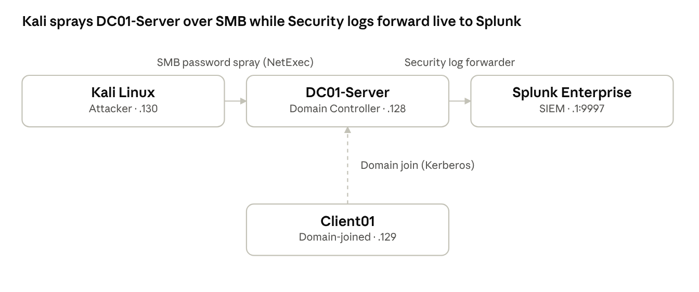
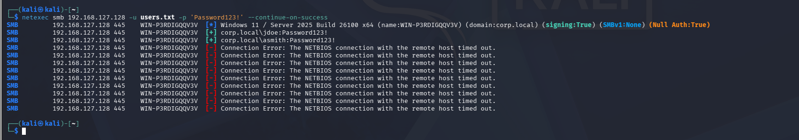
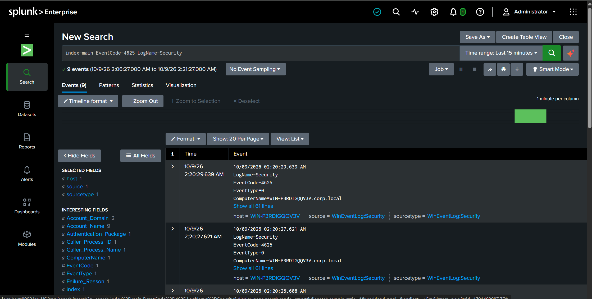
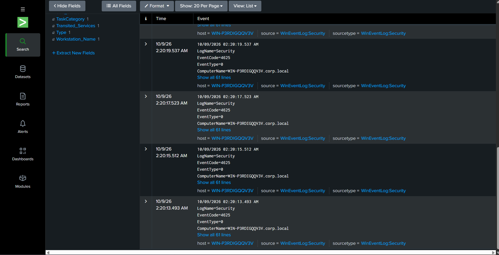
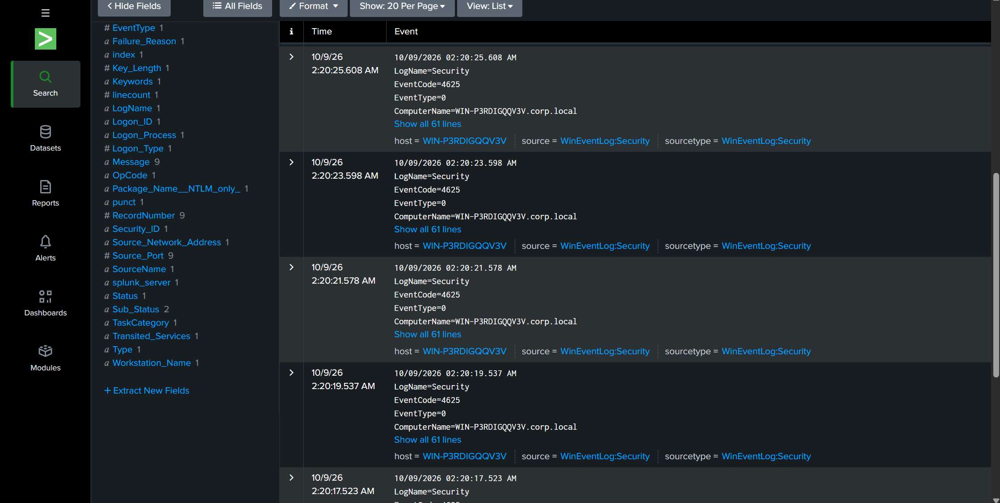
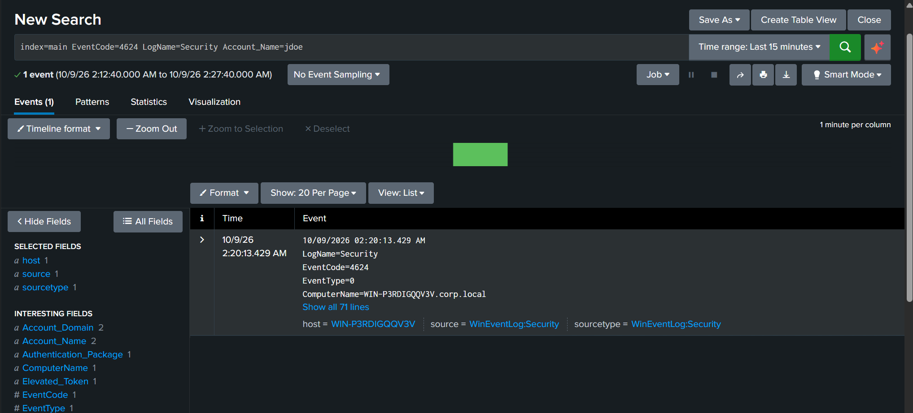
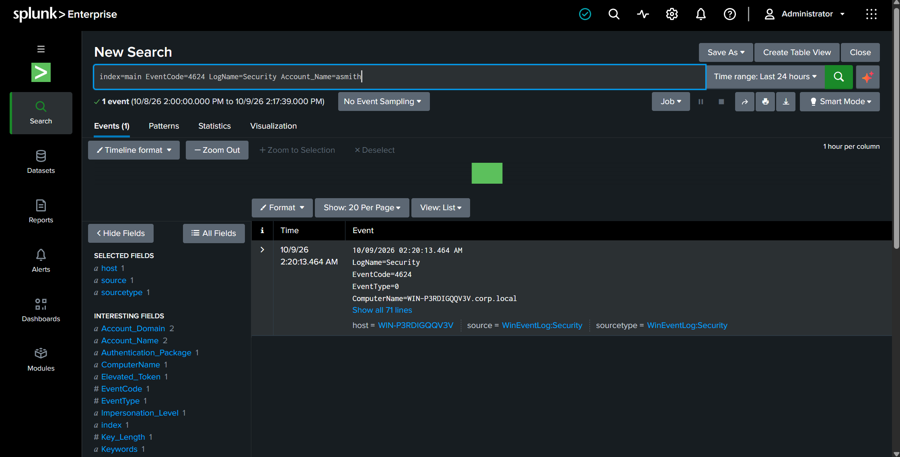
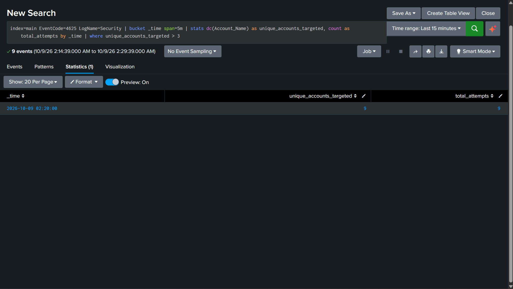
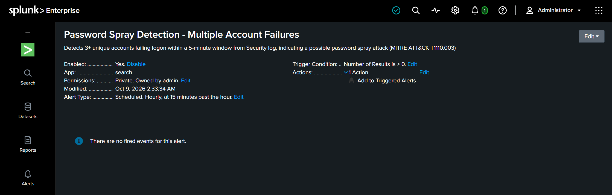

# Password Spray Attack Detection — Active Directory & SIEM Home Lab

By Mishab Shuhaib

## Executive Summary

This project simulates a real-world password spray attack against an Active Directory environment and demonstrates end-to-end detection using a Splunk SIEM. A dedicated attacker machine (Kali Linux) was used to spray a single common password across 10 domain user accounts via SMB. Two accounts (`jdoe` and `asmith`) were compromised due to weak passwords matching the sprayed value. The attack was fully captured in Windows Security event logs, forwarded to Splunk in real time, and detected using a custom correlation search that flags multiple distinct account failures from a single source within a short time window — the defining signature of a password spray ([MITRE ATT&CK T1110.003](https://attack.mitre.org/techniques/T1110/003/)).

## Lab Architecture



DC01-Server forwards its Security log live to Splunk while Kali attacks it over SMB; Client01 is domain-joined but not part of the attack path.

All systems were isolated on a VMware Host-only virtual network, with a Splunk Universal Forwarder installed on DC01-Server collecting and forwarding Windows Security, Application, and System event logs, plus Active Directory change monitoring.

| Component | Role | Details |
|---|---|---|
| DC01-Server | Domain Controller | Windows Server 2025 Standard, domain: `corp.local` |
| Client01 | Domain-joined workstation | Windows 10 Pro |
| Kali Linux | Attacker machine | Tool: [NetExec](https://github.com/Pennyw0rth/NetExec) (SMB) |
| Splunk Enterprise | SIEM / log analysis | Receiving on port 9997 |

**Target accounts (10 total, Employees OU):** `jdoe`, `asmith`, `mkhan`, `rpatel`, `lwong`, `tbrown`, `sjones`, `dkumar`, `nmiller`, `fgarcia`. One account was intentionally configured with a weak, common password to simulate a realistic point of compromise.

## Attack Simulation

A password spray attack was executed from the Kali Linux attacker machine using NetExec, targeting the Domain Controller over SMB:

```bash
netexec smb 192.168.127.128 -u users.txt -p 'Password123!' --continue-on-success
```

This attempted the single password `Password123!` against all 10 usernames. The `--continue-on-success` flag ensured every account was tested, rather than stopping at the first valid credential — accurately simulating an attacker's goal of identifying as many weak accounts as possible, not just one.

**Result:** 2 successful authentications (`jdoe`, `asmith`); the remaining accounts failed to authenticate.



## Evidence: Windows Security Event Logs

The attack generated a clear, correlated signature in the Domain Controller's Security event log, forwarded live to Splunk:

- **9x Event ID 4625** ("An account failed to log on") across 9 distinct usernames, all within an 18-second window (02:20:13 – 02:20:29)
- **2x Event ID 4624** ("An account was successfully logged on") for `jdoe` and `asmith`, occurring within the same window







## Detection Engineering

A correlation search (SPL) was built to detect this pattern automatically, rather than relying on manual log review:

```spl
index=main EventCode=4625 LogName=Security
| bucket _time span=5m
| stats dc(Account_Name) as unique_accounts_targeted, count as total_attempts by _time
| where unique_accounts_targeted > 3
```

**Detection logic:** failed logons are grouped into 5-minute windows. If more than 3 distinct accounts fail to log on within the same window, this is flagged as a likely password spray — distinguishing it from an individual user simply mistyping their own password repeatedly (one account, many failures) rather than many accounts, each failing once.

**Result when run against the attack:**

| _time | unique_accounts_targeted | total_attempts |
|---|---|---|
| 2026-10-09 02:20:00 | 9 | 9 |



This search was saved as a **scheduled Splunk alert** ("Password Spray Detection - Multiple Account Failures"), running every 5 minutes, so that this class of attack would be flagged automatically in a production environment rather than requiring manual hunting.



## Timeline

| Time (UTC+4) | Event |
|---|---|
| 02:20:13 | `jdoe` — successful login with weak password `Password123!` (Event ID 4624) |
| 02:20:13 | `asmith` — successful login with weak password `Password123!` (Event ID 4624) |
| 02:20:13 – 02:20:29 | 9 distinct accounts recorded failed login attempts (Event ID 4625) |
| ~02:21 | Detection search confirms 9 unique accounts targeted within a single 5-minute window |

## Remediation Recommendations

Based on this finding, the following controls would reduce or prevent this class of attack in a production Active Directory environment:

- **Enforce strong password policy / ban common passwords** via a fine-grained password policy or a third-party banned-password list, so accounts like `jdoe` cannot be set to common values such as `Password123!`
- **Enable account lockout policy** (e.g., lock after 5 failed attempts within 10 minutes) to limit the number of passwords an attacker can try per account before being blocked
- **Enforce MFA** for all domain accounts, particularly for any remote or VPN-accessible authentication paths, so a compromised password alone is insufficient for access
- **Monitor and alert on this pattern continuously** (as implemented above) so a real spray attack is flagged within minutes rather than discovered after the fact
- **Review and disable unused/legacy protocols** where possible, since SMB-based authentication is a common target for credential attacks

## Skills Demonstrated

- **Active Directory administration** — domain controller promotion, OU structure, user and group management, Group Policy (audit policy configuration)
- **SIEM deployment & log pipeline engineering** — Splunk Universal Forwarder configuration, Windows Event Log collection, index management, firewall/network troubleshooting for log forwarding
- **Offensive technique execution** — password spraying via NetExec/SMB, mapped to MITRE ATT&CK T1110.003
- **Detection engineering** — SPL correlation search design, threshold-based alerting, distinguishing spray patterns from benign repeated-failure noise
- **Incident documentation** — timeline reconstruction, evidence collection, remediation recommendations in a SOC-analyst report format

## Tools & Environment

- VMware Workstation (virtualization)
- Windows Server 2025 Standard (Active Directory Domain Services)
- Windows 10 Pro (domain-joined client)
- Kali Linux + [NetExec](https://github.com/Pennyw0rth/NetExec)
- Splunk Enterprise (SIEM) + Splunk Universal Forwarder

---

*All IP addresses, hostnames, and credentials in this report belong to an isolated local lab network and are not production or real-world values.*
